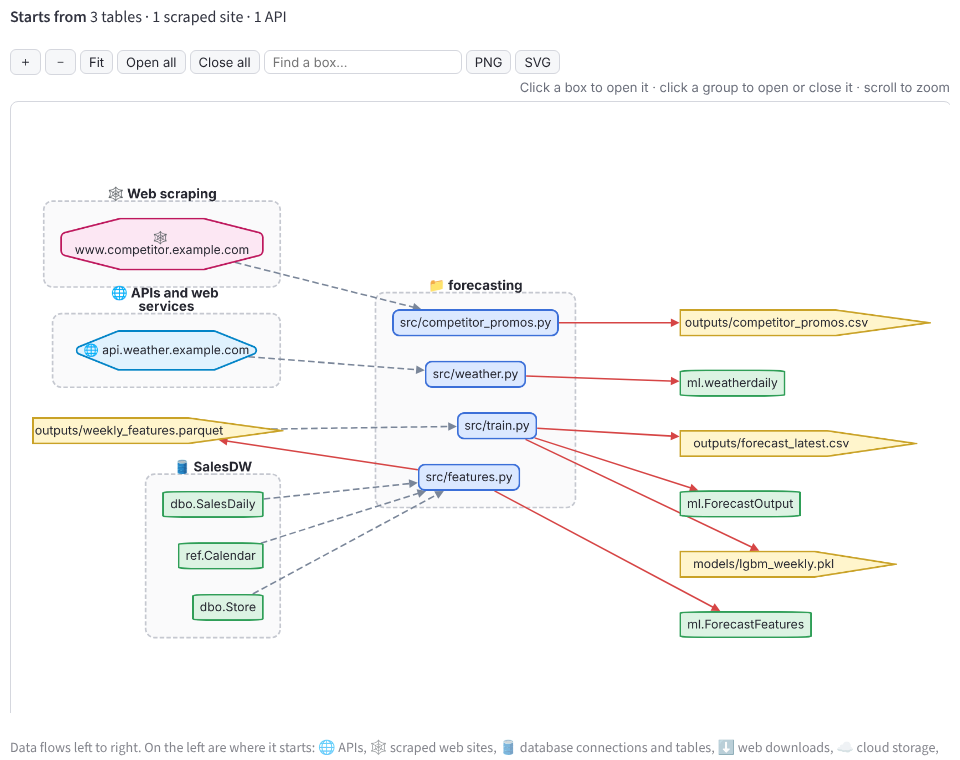

# Personal data catalogue

A small tool that runs on your own laptop and catalogues **your** data: the SQL Server
tables you can reach with your own login, your own Python projects, data files, Power BI
reports and Excel workbooks. You can search all of it, see which scripts and reports
read and write which tables, and build up what you know about it into a knowledge base
you can share with colleagues and hand to Copilot.

Nothing leaves your machine. The catalogue is one SQLite file, and your server names
and folder paths live only in a local `config.toml` that git ignores.

## Screenshots

All screenshots use made-up demo data (`python scripts/make_demo.py <folder>` builds it).

### Find

**Search** across tables, columns, scripts, files, reports, notes and knowledge. Each
result says what it matched on:


**A table page**: purpose, grain, owner and trust, the business project it belongs to,
a freshness check, and what needs reviewing. Further down: columns with value ranges,
notes, and which scripts, procedures and reports use it:


**A data file compared with the SQL table it came from**: types, ranges, nulls and
distinct counts side by side, and the scripts that write and read it:


**Dated file series**: monthly extracts become one entry, with the date range and any
missing months:


**Power BI reports**: pages, visuals, measures with their DAX, model tables, and the
SQL tables and files the report loads:


### Know

**Knowledge**: business rules, definitions and quirks that show up wherever their
trigger words do:


**ML model features**: the inputs to your machine learning models, filled from your feature code and LightGBM
models, with checks for leakage, unused features and drift:


### Review

**To review**: a prioritised list of what needs your feedback, worked out after every
scan. Tick rows to mark them done, snooze or dismiss them:


**Coverage**: how well documented the catalogue is, and what to document next (with a
draft worked out from the scan):


**Issue hotspots** (Review › Health): which schemas, folders and tables have the most
problems:


### Map

**Code map**: how your projects and home-built libraries connect, and the tables and
files they reach. Zoom, open and close groups, click a box to open it, and download as
PNG, SVG or Mermaid:


**Data flow**: an ETL-style picture of where data comes from (APIs, scraped web sites,
database connections, files, cloud storage, SharePoint, SAP) and the path it follows
through your scripts and reports to the tables and files they write:



**Power BI map**: every Power BI report, drawn bigger the more pages, visuals and measures
it has, with the tables and files it loads, the scripts that write those and where their
data comes from. Older versions are folded into the current report, and reports that load
nothing catalogued (or couldn't be read) are flagged. A table lists the same reports with
their counts, as CSV too.

**Database diagrams**: tables and how they join, split into subject areas worked out
from the joins. Rename areas and move tables; your changes are kept:


**Inside a script**: every function in the file, or zoom into one to follow what it
calls (into your libraries too), what it returns, its docstring and the data it touches:


**Environment and libraries**: what each project declares in requirements.txt,
environment.yml or pyproject.toml, compared with what the code really imports:


### Add

**Data folders** (Add › Sources): point it at any folder of CSV, Parquet, Power BI and
Excel files:


**SQL scanning** (Add › Sources): tables are only profiled when you ask. Approve them here; queries go
one at a time, and every query is logged:


## New in version 2

- **Gentle SQL Server scanning.** Queries go one at a time with a pause between them, a
  time limit each, an optional quiet-hours window and a cap per run (all on the Settings
  page; defaults 3 s, 60 s, 25 tables). Tables are only profiled when you ask, through
  an approval queue, and tables over 500,000 rows are sampled. Every query is logged.
- **Faster pages** after big scans, with an optional timings panel.
- **Value ranges for SQL tables** as well as files, with range charts, and **data type
  checks** ("this text column holds dates", "whole numbers stored as float").
- **Company-wide keys** such as PlantID: suggested from column names across databases or
  marked by you, shown as badges, used to suggest joins.
- **Sensitive columns**: values are never stored, shown or exported.
- **Dated file series**: `sales_2026-01.csv`, `sales_2026-02.csv`… become one entry with
  the date range, gaps and layout changes. Dates in folder names work too.
- **Better links between code and data**: paths through variables, `os.path.join`,
  `pathlib`, f-strings, config files and `bcp`, each link saying how it was found; add or
  hide links by hand.
- **Duplicates**: the same file in two places, copied folders, mapped drives versus
  network paths, overlapping folder sources.
- **Power BI** (`.pbix`, `.pbit`, `.pbip`): pages, visuals and the measures they show,
  DAX, model tables, relationships, and the SQL tables and files each report loads.
  **Excel workbooks**: Power Query, Microsoft Query connections, which sheet each loads
  into, pivot tables, and SQL in macros.
- **Knowledge base**: knowledge notes that stand alone or appear wherever their trigger
  words do ("Freight is always sea freight"), a question library with worked queries, a
  metric glossary (Power BI measures can become metrics), business projects that group
  tables, scripts and reports, and an **ML feature dictionary** filled from your
  feature code and LightGBM models (with leakage, unused-feature and drift checks).
- **Keeping it tidy**: purpose, grain, refresh, status, trust and owner for every item,
  with drafts worked out from the scan; describe a column once and apply it everywhere;
  edit many items in one grid; a coverage score and "document these next"; notes that
  may be out of date are flagged; change history and freshness.
- **Code map and database diagrams you can zoom**: groups for projects, folders and
  databases that open and close, third-party packages kept in one group, PNG/SVG/Mermaid
  export. Database diagrams split tables into subject areas worked out from their joins.
- **Share and merge with colleagues**: send your notes and knowledge (and optionally
  scans) as one file; merging previews what's new, keeps your words where you differ,
  and can be undone.
- **Copilot pack**: everything the catalogue knows as Markdown or Word documents for a
  Microsoft 365 Copilot agent, with instructions and starter prompts to paste.
- **OpenMetadata export** with a loader script.
- **Backups** to a folder you choose (off until you pick one), and a safe upgrade from
  version 1 that keeps an untouched copy of your old catalogue.
- **Get started page** and an optional **no-install Windows build** for colleagues who
  don't use Python.

## New in version 2.16

- **Power BI model tables and queries open pages of their own.** On a report's page, pick a row
  in **Model tables** or **Queries** to open it (parameters have buttons under the queries).
  A table's page shows its columns, the measures that live in it, its relationships (each other
  table is a link), the query that loads it, the lineage back to the database tables and files,
  and the pages and visuals that show it. A query's page shows its M code and any SQL it sends,
  what it reads (catalogued tables and files open their own page), the queries it builds on and
  that build on it, and the table it loads. Excel workbook queries open the same way. Both take
  notes and follow-ups like any other item, and work on reports you already scanned: no rescan
  needed.
- **From a visual or a measure to its table.** Picking a visual on a report page shows buttons for
  the tables it uses, and a measure's page links to its home table.
- **Measures in search show their report.** "Where" now names the report a measure is in, not
  just the scan group, and a measure with no description shows its DAX instead.

## New in version 2.14.1

- **Power BI scans no longer fail on a blank value.** pbixray hands back an empty cell (a measure
  with no expression, a query with no body, a missing description) as NaN rather than text, which
  ended a scan with `'float' object has no attribute 'strip'`. Blanks are now turned into empty
  text when the model is read, and the comparisons that run on rescans (report versions, measures
  across reports, data sources) cope with blanks already stored by earlier versions.
- **Power BI map filters:** only reports whose name or folder contains some words, only those that
  need a look, and at most N (the biggest first, 25 by default), so a big estate doesn't draw
  everything at once.
- **Big folders list faster.** A folder scan now asks the file system about each file once rather
  than three times, which matters on a network drive with 20,000 files, and the progress line for
  files that aren't opened says "Listing … (not opened …)" so it isn't mistaken for reading them.

## New in version 2.14

Folders with thousands of data files scan in minutes rather than hours, and a stopped scan
keeps what it had read.

- **Big folders are sampled by date.** A folder with more than 2,000 data files (Settings)
  opens only the newest 10 files of each dated series and the newest 2,000 stand-alone files;
  the rest are listed from the file system (name, size, modified) without being read. The
  folder card says how many files were opened, with a **Read every file** switch, and a
  sampled series says so on its page. A file read in an earlier scan keeps its rows and
  columns.
- **Daily files with a time in the name form one series.** `TOPIC_TOPIC_202304201901500.csv`
  is 20 April 2023 followed by a time, so a folder of such files becomes one daily series
  (pattern `TOPIC_TOPIC_{yyyy}{mm}{dd}{time}.csv`) instead of thousands of separate files.
  `sales_2023-04-20_190150.csv` works the same way.
- **Scans save as they go.** Power BI reports and Excel workbooks are saved a few at a time,
  then each dated series and every 200 stand-alone files, each in a short transaction. Pressing
  **Stop** (or a crash) loses only the batch being read; the scan log records the stop and the
  next scan carries on from what was saved. Files that have gone are marked missing when a scan
  completes, as before. Other windows can write to the catalogue throughout.
- **No re-scan of a folder scanned a moment ago.** Re-scan on a folder scanned in the last hour
  (Settings) asks you to press again; `pdcat scan` skips such sources unless run with
  `--force`. Unchanged files were already skipped; this saves the walk and the checks too.
- **Faster reading of each file.** The delimiter of a CSV is read off its first lines (the
  csv sniffer runs only when that isn't clear), most-common values are counted on the values
  themselves instead of a text copy of every column, and progress updates for files that
  aren't opened are drawn every half second rather than per file. On a folder of 3,000 small
  CSVs this roughly halves the time per file.
- **Measures across reports** (Map menu): the same DAX under different names in different
  reports, and the same measure name worked out differently, each with links to the measures.
  Earlier versions of a report are left out.
- **Smaller fixes:** the To review table has an **Open** button for the ticked row (clicking a
  cell only selects it); What's new no longer fails with a duplicate element key; Database
  diagrams can list the fields of chosen tables, not only all or none; package pages link to
  the package's documentation (or PyPI); the Copilot pack's test questions include a SQL
  script's reads and writes; f-strings in scripts follow attributes and calls
  (`f"{self.out}/{self.topic}_{stamp}.csv"`), so more `to_csv` targets get a file pattern
  instead of landing under Unknown files.

## New in version 2.13

**Data flow diagram** (🗺️ Map → Data flow, and on each project's page). It reads left to
right, like an ETL diagram: where the data starts, the code and reports it passes
through, and the tables and files that come out.

- **Where data comes from is now recognised in your code**, not only tables and files:
  - 🌐 **APIs**: `requests`, `httpx`, `aiohttp`, `urllib`, sessions and clients with a
    `base_url`, boto3 services.
  - 🕸️ **Web scraping**: pages fetched in a script that uses BeautifulSoup, lxml,
    requests-html and similar, Selenium and Playwright browsers, Scrapy spiders and
    `pd.read_html` on a web address. An address that looks like an API (`api.` host,
    `/api/`, `/v1/`, `.json`, OData) stays an API even in a scraping script.
  - 🛢️ **Database connections**: `pyodbc`, `pymssql`, SQLAlchemy `create_engine` (with
    `odbc_connect` too), PostgreSQL, MySQL, Oracle, SQLite, DuckDB, Snowflake, SAP HANA,
    Databricks, Teradata, JDBC and more. Connection strings are read for the server and
    database only.
  - ⬇️ **Files from the web** (`pd.read_csv("https://...")`, `urlretrieve`) and
    ☁️ **cloud storage** (`s3://`, `abfss://`, `gs://` paths, Azure Blob and S3 clients).
  - 🏭 **SAP** through `pyrfc`, with the RFC functions called (and the table for
    `RFC_READ_TABLE`).
  - In **Power BI reports and Excel workbooks**: Web.Contents, OData, SharePoint and the
    SQL Servers and ODBC sources in Power Query and workbook connections.
- **Each source is an item** (🔌 data source) you can open, describe and add notes to. Its
  page lists the addresses used and what uses it. The same API used by two projects is one
  box on the diagram.
- **Addresses never keep secrets.** Only the host and path are kept: query strings (where
  API keys usually are), user names and passwords are left out.
- **Start from one project** and the diagram also follows the data downstream (a report
  reading the table your script loads) and upstream (the script that writes the table
  your project reads). Tables and files nothing writes are grouped on the left by
  database; outputs end up on the right. Layout is automatic.
- **Where data comes from** table under the diagram, with a CSV download, plus Mermaid and
  Graphviz downloads of the diagram.
- **On every script's page** (notebooks and SQL files too) the same diagram, centred on that
  file: what it reads, what it writes, and what reads that afterwards.
- **Power BI map** (🗺️ Map → Power BI map): every report sized by its pages, visuals and
  measures, with the tables and files it loads, the scripts that write those, and the APIs
  and databases behind them. Older versions are folded into the current report, and a red
  dashed border marks a report that loads nothing catalogued, has no sources, or couldn't be
  read. The reports table beside it (biggest first) has a CSV download.
- When an address is built at run time (`requests.get(url)` with `url` from elsewhere), the
  source is still listed, named after the code that holds the address, so you can add a note
  saying where it points.
## New in version 2.12

Folder scans no longer look stuck, and big folders scan faster.

- **A progress box while scanning.** Adding or re-scanning a data folder (and scanning code)
  shows which file is being read, how many are left, how long it has taken, and any file
  that took longer than 20 seconds. The suggestions and review list worked out after a scan
  show step by step too; before, they ran with nothing on screen. A **Stop** button ends a
  scan, leaving the folder as it was before. When the scan finishes, the Data folders page
  says what was found and how long it took.
- **The terminal says what's happening.** The window the app was started from (and
  `pdcat scan`, including the weekly scheduled scan) prints an update every 30 seconds and
  names anything slow, so you can tell a long scan from a stuck one.
- **One pass over the folder.** The folder is walked once instead of four times, and the
  walk steps around folders that never hold your data: `.git`, `__pycache__`,
  `node_modules`, Python and conda environments, the recycle bin, and folders marked
  *ignore* in Folder roles. This matters most on network drives.
- **No more waiting on one big Power BI file.** With pbixray installed, a `.pbix` model is
  read in a separate process and given three minutes. If it takes longer it is stopped,
  the report page says so, and the scan carries on.
- **Big Excel workbooks read faster.** Only the start of a workbook's shared text is read to
  get the header rows, instead of all of it.
- **Adding a folder is quicker.** The app no longer re-examines the folder on every click
  while you fill in the form.
- **Far fewer "database is locked" errors.** A folder scan now reads all its files first and
  only then saves them, so the catalogue is locked for seconds rather than for the whole
  scan. Opening the catalogue no longer needs the lock at all, and anything that does have
  to wait for it waits up to a minute instead of failing after five seconds. This helps
  when the app and the weekly scan run at the same time, or when you have two windows open.
- **No more SyntaxWarnings from your scripts.** Older scripts often have things like `"\d"`
  in ordinary strings. Python printed a warning about each one while the catalogue read
  the code. They were about your scripts, not the catalogue, and are no longer printed.
- **Old versions of Power BI reports and workbooks.** Copies of one report (Sales.pbix,
  Sales_v2.pbix, "Sales - Copy.pbix", archive/Sales.pbix) are suggested as versions of one
  report, the same way script versions are. When the names don't say, two reports that share
  most of their pages, measures, tables and sources are matched by content instead. The
  newest file that isn't in an archive folder or named as old is suggested as the current
  one; only that one shows in search and diagrams once you accept. The suggestion says what
  it was matched by. Workbooks are matched by sheets and queries.
- **How a report changed over time.** A report's page gets an **Over time** section: its
  versions oldest first, each compared with the one before (pages, visuals, measures and
  their DAX, tables, sources added, removed or changed), and the changes each rescan saw in
  the file itself. Measure and page changes also go into the item's history, so they show
  under What's new › Recent changes. The group page compares any two versions.
- **A warning before a long scan.** The Add a folder form adds up the files first and warns
  when a folder holds thousands of files, gigabytes to read, or any file over 200 MB, and
  says what the scan does about it (one file at a time, changed files only on a rescan,
  large CSVs sampled, a large Power BI model given three minutes). The progress box shows
  a rough time left once a few files are in.
- **Scan log** (Add › Sources › Scan log): every scan with how long it took, how long was
  spent reading files, how much was read, the slow files and any errors; and the after-scan
  steps that took longest. A scan that took much longer than the one before is flagged at
  the top, so you can see the weekly scan getting slower before it becomes a problem.

## New in version 2.11

A tidy-up release after a code review. Nothing new to learn; the app looks and works the
same. What changed:

- **Two small fixes.** Reference documents now show their title (not `doc://…`) in search
  results and in the Home page's recently viewed list, and files under a folder marked
  *ignore* in Folder roles are now skipped when a project's data files are catalogued, the
  same as they already were for data folders.
- **Less hidden plumbing.** The post-scan finders, review checks and suggestion handlers
  are now plain imports in one list each (`postscan.py`, `review.py`, `suggestions.py`)
  instead of module names looked up by string, so a typo or a broken module shows up as
  an error instead of a feature quietly doing nothing. A review check that fails now warns
  instead of being swallowed.
- **Clearer names.** `backups.py` became `tablepairs.py` (main and backup tables; the
  catalogue backups live in `backup.py`), `drafts2.py` became `commentdrafts.py`, and the
  Copilot pack additions moved from `aipack21.py` into `aipack.py`.
- **Lint and dead code.** The code is checked with `ruff` (`ruff check src tests scripts`),
  unused imports and functions are gone, and the version number lives in one place
  (`pdcat.__version__`). The CLI closes the catalogue on every path.
- **Tests run on GitHub** for every push and pull request, on Linux and Windows.

The review notes, and what they suggest for other projects, are in
[docs/lessons-learned.md](docs/lessons-learned.md).

## New in version 2.1

Version 2.1 adds the 46 items below. Some things to know first:

- **The menu is tidier.** The app now opens on a **Home** page, the search box is always
  at the top of the sidebar, and pages that belonged together are now one page with a
  row of views: **To review** (with Data issues, Needs notes, Unmatched tables, Unlinked
  data and Duplicates), **Health** (Coverage and Issue hotspots), **What's new** (Recent
  notes and Recent changes), **Bulk edit** (Describe columns and Edit many items) and
  **Sources** (Add SQL, Data folders and SQL scanning). Company-wide keys moved to
  Knowledge, Packages to Map, and Sensitive data to Settings. The **📖 Menu guide** link
  in the sidebar explains every page.
- **Rescan after upgrading** (`pdcat scan`). Most of 2.1 is worked out from what a scan
  reads, so the SQL query library, report wireframes, report labels, renames, git
  history and the rest fill in on the first scan. Report page wireframes in particular
  need the report to be read again.
- **Switches.** Each step that runs after a scan can be turned off on the Settings page.
  Nothing already found is deleted when you turn one off.
- **Optional packages.** `sqlglot` (better SQL reading), `pypdf` (text of PDF
  documents) and `pywin32` (Access databases on Windows) are used when installed, and
  the app works without them: SQL is read with a simpler reader, PDFs are kept without
  their text, and Access files are listed but not opened. Word documents need nothing
  extra. Settings shows which are installed.
- **Nothing is sent anywhere.** The Copilot round trip and the questions for colleagues
  are files you carry yourself.

- **"Called by" on script pages**: every other script that uses a script, in one list.
  That means scripts that import it (and which of its functions they call), and scripts
  that run it with `subprocess`, `os.system`, `runpy`, `python -m`, `%run` or
  `!python`. Run links also show on the code map.
- **Link files found in another folder**: when a script names `sales.csv` but the only
  `sales.csv` catalogued is in a different folder, link it anyway and flag it as a
  possible wrong folder (before 2.1 the folders had to match). When the same file name
  turns up in several folders, it says so on the link and on the script and file pages
  (before, the newest was picked without a word).
- **Folder roles**: when you add a folder, the app suggests what it is. A *master
  folder* whose subfolders each look like their own project (their own `.git`, README,
  `environment.yml` or requirements, `src/`) becomes one project per subfolder. A
  *single project* keeps its subfolders together, each with a role suggested from its
  name and contents: code (`code/`, `src/`, `scripts/`, `notebooks/`, `sql/`), raw data
  (`raw_data/`, `raw/`, `input/`: data that comes in from outside), data (`data/`,
  `processed/`), outputs (`output/`, `results/`), docs, archive (`archive/`, `old/`,
  `backup/`: kept but treated as old), or ignore. Roles apply at any depth, so
  `forecasting/data/raw_data/` is raw data inside the forecasting project. You confirm or change each one, the choices survive rescans, and new
  subfolders that appear later are suggested the same way.
- **Business projects**: add a whole folder (a project, a sub-folder like
  `forecasting/src`, or a data folder) in one go, with an option to keep adding new files
  that appear there. Start a new business project straight from a table or script page,
  with that item already in it.
- **Mark items as not relevant**: one click hides a table such as `dbo.sysdiagrams` from
  search, the review list, coverage, diagrams and exports; scans keep it hidden, and a
  list lets you bring it back. Tables SQL Server tools create for themselves (marked
  `microsoft_database_tools_support`, like `sysdiagrams`) are skipped by default.
- **ML model features** (was the feature dictionary): says up front that it lists the
  inputs to your machine learning models. Each row names the models that use the
  feature, the script that builds it and the table and column it comes from, each one a
  link, instead of a bare count of models.
- **Copilot pack test questions**: the Copilot pack page lists ten or so questions built
  from your own catalogue ("Which scripts write ml.ForecastOutput?", "What does Forecast
  accuracy mean?", "What replaces dbo.Store?") with the answer the pack holds, so you can
  ask Copilot and check it gets them right. They also go in the pack as a test file.
- **Import from an Excel sheet**: upload a workbook, pick the sheet, and say what each row
  is: a SQL query (title, SQL, notes become pasted SQL linked to the tables it uses, or
  question library entries), a metric (name, definition, formula, e.g. how forecast
  accuracy is calculated), or a knowledge note. Match columns to fields, preview, then
  import; each item remembers which workbook it came from. A sheet of free text can be
  imported whole as one knowledge note.
- **Reference documents on business projects**: attach design documents (Word, PDF,
  Markdown, text) to a business project. Add a new version at any time and every older
  version is kept, newest first, with its date. Tables, scripts and other catalogued
  items the document names are highlighted in the text and listed as links, and those
  items show the document on their own pages. Document text is searchable and can go in
  the Copilot pack.
- **Menu guide**: a link that always shows in the sidebar, opening a page that explains
  every section and page in the menu in a line each, with a button to open it.
- **Installed conda environments**: read the conda environments on your machine (from
  each environment's `conda-meta` folder, without running conda) and record every
  installed package with its exact version and channel. Each environment gets its own
  page, you can link a project to the environment it runs in, and the project page
  compares what's installed with what the code imports and what `environment.yml` asks
  for (missing, extra, or a different version).
- **Import a schedule list**: bring in a CSV that lists scheduled jobs (a Task Scheduler
  export, a job list, a hand-kept sheet). You pick which columns hold the job name, the
  command and the timing. Each job is matched to scripts by the command or path it runs,
  or by a script, folder or project name in any column. A clear match is linked; a
  likely one is shown as a suggestion for you to confirm or change; anything else is
  listed as unmatched so you can link it by hand. Script pages then show when they run.
- **Find more output files**: spot files a script writes in ways the scan misses today:
  `df.to_csv(filepath)` where `filepath` is passed in as a function argument (followed
  back to the call that gives the real path), imported from another module
  (`from settings import OUTPUT_DIR`), an argparse default, a `self.` attribute or
  returned by a helper function; paths looked up in a config dictionary in code;
  every branch of an if/else; `pd.ExcelWriter`, `Path.write_text` and
  `Path.open`, `np.save`, `shutil.copy`, polars `write_csv`/`write_parquet` and openpyxl
  `wb.save`.
  Every read or write call is recorded even when its path can't be worked out: the
  script page lists it as "Unknown file" with the line and the code (`df.to_csv(filepath)`),
  it goes on the To review list, and you can say which file it is, which then links it
  like any other.
- **Script versions**: scripts in the same folder whose names differ only by a version
  or date at the end (`forecast_v2.py`, `forecast_v3.py`, `forecast_20261001.py`,
  `forecast_old.py`, `forecast - Copy.py`) are grouped as versions of one script. The
  current one is the one other code imports or runs, or the one in the schedule list,
  or else the newest; when that isn't clear, you tick the main one. Only the current
  version shows on the code map, in search and in lineage. Older versions stay listed
  on its page with their dates and a "what changed" view, and you can split a pair that
  aren't really versions.
- **Main and backup tables**: link a table on SQL Server with its copy elsewhere (an
  Azure SQL backup with extra history, say) and mark which is the main one. Pairs are
  suggested when the same table name and columns turn up on two servers, for you to
  confirm. Both pages show the pair side by side: where each lives, the date range each
  covers (from the profiles), row counts and any columns only one has. On the code map
  and in lineage the pair shows as one table with a "main + backup" badge, so a script
  that reads both is clear about why.
- **Copilot round trip**: export a "gaps pack" of items with no description, with their
  code and columns, for your Copilot agent to draft descriptions; import its answers as
  suggestions you accept or edit. No AI service is connected to the catalogue. It's on
  the Copilot pack page under Round trip: the pack asks for a CSV of `id,column,answer`,
  which you paste or upload back. Naming rules the app couldn't read go in too, and
  Copilot's rewrite comes back as rules to confirm.
- **Descriptions from comments**: draft descriptions from SQL comments, docstrings,
  notebook markdown and comments next to column renames, as suggestions.
- **Column renames in lineage**: `rename({"Units": "qty"})` or `SELECT Units AS qty`
  links the two columns. Both names are shown, with the script and line where it was
  renamed, and the new column inherits the old one's description as a suggestion.
  Column lineage follows the chain through every rename.
- **Report labels**: Power BI display names and visual titles suggested as business
  names for the SQL columns behind them.
- **Git history**: who last changed a script, when, and the commit messages, used to
  suggest owners and show a change log.
- **Freshness and old items**: output files' modified dates show whether the scripts
  that write them still run. Outputs that keep refreshing earn a "refreshing" badge and
  drop out of your way; ones that stop go on the To review list asking for a refresh or
  a note on whether they're still needed. Scripts and projects nobody has touched or
  run in a long time are flagged the same way. You can mark projects, scripts and files
  as old, which hides them from the code map and diagrams (a switch shows them again)
  without deleting their notes.
- **Rules become checks**: a rule you write ("Units is never negative", "loaded daily
  by 7am") becomes a check run with each profile; failures go to review. Write them in
  the **Rule checks** box on a table or file page. It reads never negative / always
  positive, never blank, unique, between A and B, at least / at most N, one of A, B, C,
  at least N rows, and loaded daily / weekly / monthly / every N days (optionally "by
  7am", checked against the newest date in the data or a file's modified time). Rules
  already sitting in notes and column descriptions are offered as checks to add.
- **Questions for colleagues**: a share file holding only your open questions, which a
  colleague answers in their catalogue and merges back into yours (Share › Share with
  colleagues). Their reply is an answers file holding only the questions you asked.
- **Five quick questions**: a short daily list of the highest-value gaps, each answerable
  in under a minute, mostly by confirming a suggestion.
- **Learn from your queries**: joins and filters that come up again and again in pasted
  SQL and scripts become "how this table is usually used" notes and join hints.
- **Home page**: opens first. It shows your follow-ups, what changed since your last
  visit, your five quick questions, and anything failing or no longer refreshing.
- **Follow up**: a "Follow up" tick on any table, script, file or knowledge page pins it
  to the home page (with an optional note on where you were), so you can get back to
  what you were working on. Untick it when you're done.
- **Search box always in the sidebar**, so you can search from any page.
- **Search results as a table**: a sortable table with kind, name, where it lives,
  description, what it matched on, rows, last changed or scanned, notes, status and
  trust, and how many scripts use it. Filter by kind or source in the table, click a row
  to open it, and switch back to the card view if you prefer. File families show as
  one row ("SOH: daily, weekly, monthly") that opens to its members. Quick filter
  buttons above the results (Tables, Files, Code, Reports and measures, Metrics,
  Knowledge) replace hunting through the Kind list, and a metric found in search shows
  the Power BI measures and SQL that calculate it, and the reverse. A "Group by" choice
  regroups the results: by the script that creates them (so ten outputs of one script
  sit under that script, with anything nothing creates under "Not linked to a script"),
  by family, by folder or database, by business project, or not at all.
- **Remove or downplay links**: every link on an item's page (uses, created by, read by)
  gets a small menu: *Remove* for a link the scanner got wrong, or *Not important* for
  one that's right but noise (a script that only reads a lookup table, say). Unimportant
  links stay listed but greyed out, and are left out of grouping, diagrams, lineage and
  "used by" counts. Both survive rescans, show who set them, and can be undone from a
  "Removed and unimportant links" list.
- **SQL query library**: every SQL query found in scripts, notebooks, .sql files, Excel
  (Power Query and macros), Power BI and reference documents becomes a saved query,
  alongside the ones you paste in. Each gets a suggested name (from the variable or
  function holding it, a comment above it, or its file), which you can change, and
  records where it was found and the tables it uses. The same query found in several
  places is shown once, listing every place. A "SQL queries" page lists them all as a
  table you can sort, filter by table or source and pick from to see the query.
  Each table's page gets a "SQL using this table" section listing every query that
  references it, active ones first: in a scheduled script, a script whose outputs are
  still refreshing, the current version of a script, a view or procedure that exists
  now, or edited recently. Queries in old versions, old projects or items marked old
  sit below, greyed out. Each shows its name, where it is, how it uses the table
  (reads, joins on which columns, writes) and any SQL check findings.
- **Query diagrams with fields**: looking at a query (saved, pasted, a view or a
  procedure) shows a diagram of just the tables it uses, with their columns listed, the
  columns the query uses highlighted, and lines between the exact fields it joins on
  (from its ON clauses, plus the database's keys). Database diagrams get the same "show
  fields" view for any group of tables.
- **Access databases**: .accdb and .mdb files found in data folders are read for their
  saved queries (name and SQL, which go in the SQL query library), linked tables (what
  each points to, for example a SQL Server table, another Access file or a spreadsheet,
  with the connection's password removed, and linked to that item in the catalogue),
  and local tables with their columns and row counts. It opens the file read-only and
  never runs a query. On Windows it uses the Access Database Engine through DAO (from
  pywin32), so the engine's 32/64-bit version must match Python's; the setup page checks
  this and says what to install if it's missing.
- **SQL checks**: every saved query, view and procedure is checked (without running it)
  for common problems, each with a short reason and a suggested fix:
  - *Likely wrong results*: a join with no join condition, `NOT IN` on a column that can
    be empty, joining on a column that isn't unique (rows multiply; checked against
    profiles), comparing columns of different types, `BETWEEN` on date-times, dividing
    without guarding against zero, tables or columns that no longer exist or are marked
    deprecated.
  - *Slow*: `SELECT *`, functions wrapped around filtered columns (`YEAR(SaleDate) = 2025`),
    `LIKE '%...'`, `DISTINCT` covering duplicates, `UNION` where `UNION ALL` would do,
    cursors and loops in procedures.
  - *Risky*: `NOLOCK` on data that must be exact, hard-coded dates, missing schema names,
    and SQL built by pasting variables into strings in scripts (an injection risk).
  Findings show on the query's page and in a column on the SQL queries page, can be
  marked "fine here", and the worst ones go on To review.
- **Recently viewed** items in the sidebar.
- **Edit history** on notes and descriptions: who changed what and when, with undo.
- **Schedule scans from the app**: a Settings button that creates (or removes) the
  weekly Task Scheduler task for you, and shows when it last ran and whether it worked.
- **Naming rules audit**: paste a database's naming rules as text (from an email, say)
  on its page. The text is kept as written, and each rule the app recognises becomes a
  check you confirm or edit: prefixes (`vw_` for views, `usp_` for procedures), case
  (PascalCase, snake_case), endings (`...ID`, `...Date`), no spaces or reserved words,
  maximum length, which schema things belong in. Rules it can't turn into a check stay
  as text, and the Copilot round trip can help write them. The audit shows each rule
  with how many tables, views, procedures and columns pass, the ones that don't, and
  lets you mark agreed exceptions. New objects that break a rule go on To review, the
  results export to CSV, and the rules go in the Copilot pack so queries Copilot
  writes follow them.
  Rules can also be worked out from what's already there: for a database or a Python
  project, the app looks for the habits most names follow (say 92% of views start with
  `vw_`, columns are PascalCase, date columns end in `Date`, scripts are `snake_case.py`,
  output files are named `<thing>_<yyyymmdd>.csv`) and suggests each as a rule, with how
  many names follow it and examples of the ones that don't. You accept, edit or reject
  each suggestion; accepted ones are audited like pasted rules.
- **Tidier "Contains" lists**: a folder's contents show dated copies of the same data
  as one line per series (`sales_{yyyy}{mm}.csv · 48 files · Jan 2022 to Dec 2025`),
  opening to the files, and the rest grouped by subfolder and type, as a sortable table
  with a filter box instead of a long list of buttons. Scripts help find the series: a
  script that writes `f"out/sales_{run_date}.csv"` shows that every file matching
  `out/sales_*.csv` is one output, so they're grouped even when the part that changes
  isn't a recognisable date (a run number, a version, an odd date format), and the
  series links back to the script that makes it.
- **File families by grain**: files with the same base name and a grain suffix
  (`SOH_D`, `SOH_W`, `SOH_M`; also `_daily`, `_weekly`, `_monthly`, `_Q`, `_Y`) are
  grouped as one family, "SOH", while each stays its own item. The family page compares
  them side by side: the grain (from the suffix, checked against the spacing of the
  dates inside once profiled), date range, rows, columns that differ, and which scripts
  write and read each. The grouping is suggested for you to confirm, and you can add
  your own suffixes.
- **Starter knowledge packs**: optional packs of general knowledge you can load into the
  Knowledge section and Metric glossary, marked "general" so they're kept apart from
  what's specific to your data, and editable like anything else (loading again never
  overwrites your edits). First packs:
  - *Supply chain*: forecast accuracy (MAPE, WAPE, bias), safety stock, lead time,
    service level, fill rate, OTIF, inventory turns and days on hand, MOQ, ABC/XYZ,
    S&OP, demand vs supply planning terms.
  - *SAP*: the common tables and fields and what they mean (material master `MARA`/`MARC`,
    plants `T001W`, sales orders `VBAK`/`VBAP`, deliveries `LIKP`/`LIPS`, purchase orders
    `EKKO`/`EKPO`, stock movements `MATDOC`/`MSEG`; fields such as `MATNR`, `WERKS`,
    `LGORT`, `MEINS`), plus APO (planning books, key figures, DP and SNP), EWM
    (warehouse tasks, storage bins, handling units) and IBP (key figures, planning
    levels, attributes such as `PRDID` and `LOCID`).
  - *SQL Server good practice*: a general reference for writing and reviewing T-SQL:
    joins and NULLs, sargable filters and indexes, date handling, `NOLOCK` and isolation
    levels, temp tables vs table variables vs CTEs, window functions, set-based work
    instead of cursors, safe dynamic SQL, naming and formatting. Each SQL check links to
    the article that explains it, and the articles go in the Copilot pack.
  - *APO to IBP*: what changed in the move, as a side-by-side guide: APO DP becomes IBP
    for demand, SNP becomes IBP for supply (and response); planning books and data views
    become planning views (mostly in the Excel add-in); characteristics and CVCs become
    master data attributes and planning objects; location products become
    product-location master data; macros become key figure calculations and planning
    operators; and how forecasting, time buckets, lifecycle and realignment differ.
    Each pair says what to check when an old APO report, extract or metric is rebuilt
    on IBP data.
- **Link data to SAP**: mark what a table or column is in SAP terms ("PlantID is SAP
  `WERKS`", "this table is an extract of `MARC`"). Matches are suggested from column
  names (SAP field names, or common English names such as Material and Plant), for you
  to confirm. Linked items show the SAP meaning on their page, company-wide keys gain
  their SAP field, and the Copilot pack explains both so Copilot can answer in either.
  Data and scripts that still use APO (its tables, extracts or key figures) are flagged
  with the IBP equivalent, so you can see what needs moving and what already has.
- **Power BI measures as a table**: a report's measures (some have hundreds) show as a
  sortable, filterable table: name, home table, display folder, format, what it uses
  (columns and other measures), which pages and visuals show it, and whether it's in
  the glossary. Group by home table or display folder, filter to "uses another
  measure", and click a row to open it. Each measure is marked used or unused: used
  means a visual shows it, or a used measure builds on it (followed through every
  step). Unused ones are hidden by default, with a count and a switch to show them.
  Because other reports connected to a published dataset can use measures this file
  can't see, it says "not used in this file" rather than "unused".
- **Report page pictures**: a .pbix holds the layout of each page but no picture of
  the charts (Power BI draws them when the report opens). So each report page gets a
  wireframe drawn from its layout: every visual in its place, with its type, title and
  fields, and a click shows its measures. You can also paste or upload a screenshot of
  a page or visual to keep with it. Screenshots stay on your machine and are left out of
  share files and exports unless you tick them in, since they can show real numbers.
- **A tidier menu**: To review takes in Data issues, Needs notes, Unmatched tables,
  Unlinked data and Duplicates as filter tabs; Coverage and Issue hotspots become one
  Health page; Recent notes and Recent changes become one What's new page; Describe
  columns and Edit many items become one Bulk edit page; Add SQL, Data folders and SQL
  scanning become one Sources page; Company-wide keys moves to Knowledge, Packages to
  Map, and Sensitive data to Settings.
- **Suggested metrics**: the Metric glossary suggests metrics found in your code and
  reports: functions such as `wape()` or `forecast_accuracy()`, named calculations
  (`mape = ...`), computed SQL columns (`SUM(x) / SUM(y) AS fill_rate`), and Power BI
  measures not yet in the glossary. Each suggestion shows where it was found and the
  formula, and you tick the ones to add; the rest can be dismissed so they don't come
  back.

## Ideas for a later version

Asked for while testing 2.1, and kept here to build in the next version:

- **Likely values for metrics**: show the values a metric usually takes (its typical range,
  from the profiles of the columns it is calculated from) when it is suggested or shown in
  the Metric glossary.

## Upgrading from version 1

Install the new version the same way as before (`pip install -e .` or
`conda env update -f environment.yml --prune` then `pip install -e . --no-deps`) and run
`pdcat ui`. The first time it opens your catalogue it upgrades it in place and keeps an
untouched copy of the old file next to it (the path is shown in the app and on the
Settings page). Nothing is removed; every note is kept. Rescan to fill in the new
details (`pdcat scan`).

To upgrade from 2.0 to 2.1, install the same way and rescan; see
[New in version 2.1](#new-in-version-21).

Version 2 needs Streamlit 1.62 or later; both install commands above update it. With an
older Streamlit the app can stop with "Exception in ASGI application … Expected
http.response.start", which comes from older Streamlit clashing with a newer Starlette.
To update just Streamlit: `pip install -U "streamlit>=1.62"` (or
`conda install -c conda-forge "streamlit>=1.62"` in a conda environment).

## What it does

- **Scans SQL Server** with your Windows login: tables, views and stored procedures,
  their columns and types, row counts, and any existing `MS_Description` descriptions.
  It reads view and procedure definitions to find which tables they read and write.
- **Scans Python projects**: `.py` files, notebooks (`.ipynb`) and `.sql` files. It
  records each file's docstring, functions and imports, and finds the tables and files
  the code uses: SQL in strings and f-strings, `read_sql_table` / `to_sql`,
  `read_csv` / `to_parquet` and friends, `open()`, `joblib.dump/load`, `save_model`.
- **Matches table names in code to scanned tables**, so a table page shows "used by
  `features.py` (reads)" and a script page shows the tables it touches.
- **Paste in SQL by hand** ("Add SQL" in the web page): give it a title and a note, and
  it becomes a searchable item linked to the tables it reads and writes, so it shows
  up under "Used by" on those tables. Pasted SQL is never touched by scans.
- **CSV and Parquet files as data sources**: files inside your projects, plus any other
  folder you add from the **Data folders** page (paste the folder path, it scans every
  CSV/Parquet in it). Each file records its size, modified date, row count and columns.
  Scripts are linked to the files they write, including dated names like
  `f"outputs/forecast_{month}.csv"` (matched to the newest file).
- **Value profiles**: nulls, distinct counts, min/max, mean and most common values per
  column. Data files are profiled when scanned; SQL tables with `pdcat profile`.
- **Compare side by side**: on a file or table page, compare its columns, ranges and
  null rates with another one. It suggests where the data came from (the tables read by
  the script that wrote the file), so you can see what changed between the core SQL
  table and your local extract.
- **Notes, data issues and example values** on any table, column, view, file, script or
  project. Data issues stay open until you mark them resolved and are listed on their
  own page. Example values keep their layout, so you can paste sample rows or ranges.
  Notes are stored separately from scanned data, so re-scanning never touches them.
- **To review list**: after every scan the catalogue works out what needs your eyes:
  undocumented tables and columns, objects that are new, changed or have disappeared,
  odd values (mostly empty or constant columns, negative quantities, future dates),
  CSV/Parquet files whose values go outside their source table, files that look out of
  date, and table names in code that match nothing. It's ordered for big databases:
  things your own code uses, large tables, and tables with open issues come first, and
  "Only items my code uses" narrows it further. Your done/snoozed/dismissed choices stick,
  and problems that get fixed drop off by themselves. Also `pdcat review` in a terminal.
- **Issue hotspots**: schemas, folders and items ranked by open data issues, automatic
  warnings, disappearances and missing documentation.
- **Code map of your projects and home-built libraries**: every import is matched to
  the file that provides it, across projects and libraries (including relative imports),
  and labelled with the functions used. It records which tables and files each *function*
  touches, so "Data reached through libraries" shows exactly what a project ends up
  reading or writing via `common_utils.load_sales()` and further down the chain. Flow
  diagrams at project or file level, on the Code map page and on each project's page.
  Libraries you haven't added yet are spotted from editable installs and `sys.path`
  additions and can be added with one click; `pdcat diagram` writes Mermaid or DOT.
- **Zoom into scripts**: every function, method and nested function is listed with its
  parameters, docstring, what it calls and what it returns. Pick a function to see a
  diagram of its sub-functions (1 to 5 levels deep, following calls into your other
  projects and libraries), the tables and files each one uses, and what calls it, from
  this file or any other. Zoom back out to the whole script or the whole project.
  Links like `?asset=…&fn=train` open straight at a function.
- **Environments and packages**: reads `requirements*.txt`, conda `environment.yml`,
  `pyproject.toml` (including Poetry), `setup.cfg`, `setup.py` and `Pipfile`. Each
  project page shows the Python version, conda env and channels, local `-e` installs,
  the declared packages, packages imported but not declared (`sklearn` is matched to
  `scikit-learn` and so on) and packages declared but never imported. The Code map page
  has one table of packages across all projects, to spot different versions.
- **Search** across names, columns, descriptions, notes, knowledge and tags.
- **Needs notes** view: undocumented tables, the ones your code uses most first.
- **Export everything** (items, columns, links, notes, profiles and your knowledge) as
  CSV or JSON, from the web page or the command line, so you can move it into another
  tool later.

Version 2 adds Power BI and Excel, the knowledge base, sharing, the Copilot pack and
more: see [New in version 2](#new-in-version-2).

## Setup (Windows)

You need the Microsoft ODBC Driver for SQL Server (17 or 18). Most work laptops
already have it: search the Start menu for "ODBC Data Sources" and look under
**Drivers**. Read [SECURITY.md](SECURITY.md) for what the tool connects to and stores.

### With conda (recommended if you use Anaconda or Miniconda)

Open an **Anaconda Prompt** (or any terminal where `conda` works) and run:

```powershell
git clone https://github.com/Nichevo/personal-data-catalogue.git
cd personal-data-catalogue
conda env create -f environment.yml     # creates an environment called "pdcat"
conda activate pdcat
pip install -e . --no-deps              # adds the pdcat command; conda already installed the packages
pdcat init
```

- **Every new terminal:** run `conda activate pdcat` before `pdcat scan` or `pdcat ui`.
- **After pulling new code:** `conda activate pdcat`, then
  `conda env update -f environment.yml --prune`, then `pip install -e . --no-deps`.
- **Separate from your project environments:** pdcat has its own environment and
  never touches your forecasting or other environments. It reads your projects'
  `environment.yml` / `requirements.txt` files as text, so it doesn't need their
  packages installed.
- **Another name or location:** `conda env create -f environment.yml -n my-catalogue`,
  or `-p C:\envs\pdcat`.
- **Channel:** packages come from `conda-forge` only, which is free to use. If your
  network blocks conda-forge, ask IT for the internal mirror and add it with
  `conda config --add channels <mirror-url>`.
- **To remove it:** `conda deactivate`, then `conda env remove -n pdcat`.

### Or with a plain virtual environment

You need Python 3.11+.

```powershell
git clone https://github.com/Nichevo/personal-data-catalogue.git
cd personal-data-catalogue
py -m venv .venv
.venv\Scripts\activate
pip install -e .
pdcat init
```

### Then

`pdcat init` creates `%USERPROFILE%\.pdcat\config.toml`. Open it and fill in your
servers and project folders:

```toml
db_path = "~/.pdcat/catalogue.db"

[[sqlserver]]
name = "warehouse"                 # a short label you choose
server = "YOUR-SERVER\\INSTANCE"
databases = ["YourDatabase"]
driver = "ODBC Driver 18 for SQL Server"
trust_server_certificate = true

[[python]]
name = "forecasting"
path = "C:/Users/you/code/forecasting"
exclude = ["data", "outputs"]
default_database = "warehouse/YourDatabase"   # where bare table names like "Sales" live

[[python]]                         # a home-built library your projects import
name = "common-utils"
path = "C:/Users/you/code/common-utils"
role = "library"
```

If your server uses Azure AD sign-in instead of Windows login, add
`extra = "Authentication=ActiveDirectoryInteractive;"` to that block.

## Use

Most of the time you only need two commands:

```powershell
pdcat scan      # read your databases, projects, folders, reports and workbooks
pdcat ui        # open the catalogue in your browser (leave the window open while you use it)
```

Re-run `pdcat scan` whenever your code or databases change. Anything that has
disappeared is marked "missing" rather than deleted, and its notes are kept.

Everything else can be done from the app, or from the terminal:

| Command | What it does |
| --- | --- |
| `pdcat init` | Create a starter config file |
| `pdcat scan` | Scan everything in the config (`--source NAME` for one; `--plan` to see the SQL first) |
| `pdcat ui` | Open the catalogue in your browser |
| `pdcat profile dbo.SalesDaily` | Measure value ranges, nulls and common values of tables (`--used` for all your code uses) |
| `pdcat review` | What needs your attention, most important first |
| `pdcat search "store sales"` | Search from the terminal |
| `pdcat diagram --out map.mmd` | The code map as Mermaid or Graphviz text |
| `pdcat share --out mine.json` | Your notes and knowledge in one file, for a colleague |
| `pdcat merge theirs.json --preview` | See what a colleague's file would change; drop `--preview` to merge |
| `pdcat ai-export --out copilot-pack` | The Copilot pack (`--docx` for Word, `--hide-locations`) |
| `pdcat export` | Everything as CSV (or `--format json`) |
| `pdcat openmetadata --out om.zip` | Tables, descriptions, glossary and lineage for OpenMetadata |

**[Command reference](docs/commands.md)**: every option, with examples and what the
output looks like. In the terminal, `pdcat --help` lists the commands and
`pdcat <command> --help` shows one command's options and examples.

To refresh the catalogue automatically every week, see
[Scan on a schedule](docs/commands.md#scan-on-a-schedule): a ready-made batch file and one
Task Scheduler command.

## Export format

| File | One row per | Key columns |
| --- | --- | --- |
| `assets` | table, view, procedure, database, project, script, notebook, data file, file series, report, measure, workbook, ML model, pasted SQL (`sql_snippet`, text in `attrs.sql`) | `key`, `kind`, `name`, `source`, `description`, `attrs` (JSON) |
| `columns` | column of a table or view | `asset_key`, `name`, `data_type`, `description` |
| `links` | "this reads/writes/calls that" | `src_key`, `relation`, `dst`, `matched`, `evidence` (file:line) |
| `notes` | your note, data issue or example | `asset_key` (`<key>#<column>` for column notes), `note_type`, `status`, `body`, `tags`, `author` |
| `profiles` | column of a profiled table or file | `asset_key`, `column_name`, `row_count`, `null_count`, `distinct_count`, `min_value`, `max_value`, `mean_value`, `top_values`, `histogram`, `percentiles` |
| `item_info` | item you've described | `asset_key`, `purpose`, `grain`, `refresh`, `lifecycle`, `trust`, `owner`, `sensitive` |
| `column_info` | column you've described or marked sensitive | `asset_key`, `column_name`, `description`, `sensitive` |
| `relationships` | join between two tables | `src_key`, `src_columns`, `dst_key`, `dst_columns`, `how`, `state` |
| `knowledge`, `questions`, `metrics` | knowledge note, worked question, metric | `title` / `question` / `name`, then the body, SQL or definition |
| `features` | ML feature in the dictionary | `name`, `project`, `description`, `window`, `known_at_prediction`, `models` |
| `keys`, `key_columns` | company-wide key, and the columns that hold it | `name`, `asset_key`, `column_name` |
| `business_projects`, `business_project_members` | business project, and the items in it | `name`, `purpose`, `asset_key` |
| `functions` | function in your code | `asset_key`, `function`, `line`, `parameters`, `returns`, `calls`, `doc` |
| `packages` | package a project declares or imports | `project`, `package`, `version`, `declared_in`, `status` |
| `series_files` | file in a dated file series | `series_key`, `file`, `period`, `rows`, `layout_differs` |
| `change_history` | change seen by a scan | `asset_key`, `at`, `change`, `detail` |

Values from columns marked sensitive are never exported.

Keys look like `sql://warehouse/yourdatabase/dbo.sales`,
`py://forecasting/src/features.py` and `files://extracts/sales.csv`. CSVs are UTF-8 with a BOM so Excel opens them cleanly.

## Good to know

- Security and privacy: see [SECURITY.md](SECURITY.md). In short: SQL Server access is
  read-only, code is parsed but never run, everything stays in a local unencrypted
  file, and value profiles store real data values.

- Table detection in code is a pattern match, not a full SQL parser. Dynamic table
  names (`f"FROM {table}"` where `table` isn't a constant) are skipped, and the
  **Unmatched tables** view lists names that didn't match anything, so you can spot
  missing servers or false positives.
- The scanner only reads system catalogue views, so it sees exactly what your login
  can see and changes nothing on the server.
- Profiling runs a few aggregate queries per table (with `NOLOCK`, so it never blocks
  anyone), one at a time at the pace set on the Settings page. Tables over the sampling
  threshold (500,000 rows by default) are measured from a `TOP (n)` sample.
- Power BI `.pbix` files keep their model compressed. Pages, visuals and queries are
  always read; for the DAX and model tables install the optional readers
  (`pip install -e ".[office]"`, which adds `pbixray` and `olefile`), or save a copy as
  `.pbit` or `.pbip`.
- Large data files are profiled from their first 200,000 rows (`max_rows` in the
  config). Parquet row counts are always exact; for big CSVs the count is a line count.
  Unchanged files are not re-read on the next scan.
- Keep secrets out of `config.toml`. Windows login means there is no password to store.

## Development

```powershell
pip install -e ".[dev]"                 # or, in the conda env: pip install -e . --no-deps
pytest
ruff check src tests scripts            # lint (same rules as the GitHub check)
python scripts/make_demo.py C:\temp\pdcat-demo     # sample catalogue to try the app with
streamlit run src/pdcat/app.py -- --db C:\temp\pdcat-demo\catalogue.db
```

## No-install Windows build (optional)

For colleagues who don't use Python, `packaging/windows/build.ps1` makes a zip holding a
complete Python environment (conda-pack) and a **Start catalogue** launcher. They unzip
it and double-click; the Get started page does the rest. GitHub Actions builds it and
attaches it to each release (`.github/workflows/windows-build.yml`). Their catalogue
lives in `%USERPROFILE%\.pdcat`, so a newer zip just replaces the old folder. They
still need Microsoft's ODBC driver to scan SQL Server.

The graph viewer's JavaScript (Cytoscape, ELK and two Cytoscape extensions) is copied
into `src/pdcat/ui/graph/vendor` with its licences, so the app needs no internet.
